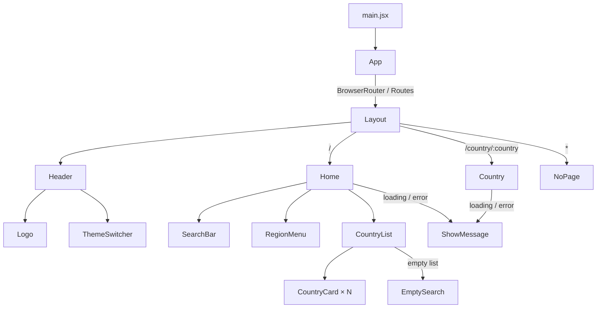
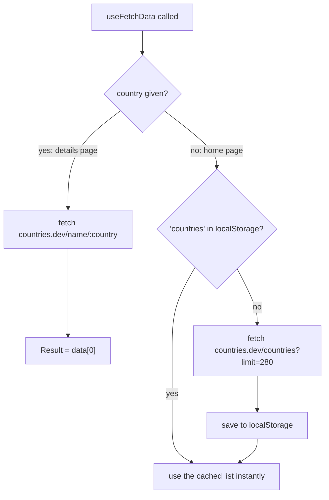

# All Around the World

> A React 19 app for exploring every country in the world. Search countries by name, filter them by continent, open a details page for any country, and switch between light and dark mode. Country data is cached in the browser, so the app opens instantly on later visits.

**🌍 Live demo:** <https://all-around-world.vercel.app/>


## 🎬 Demo


▶️ **Full walkthrough with voice-over (Egyptian Arabic, 1 min 40 s).** Press play below to watch it with sound:

<!--
  HOW TO SHOW THE FULL VIDEO WITH SOUND (one time, about 1 minute):
  1. Open this README on GitHub and click the ✏️ (Edit) button.
  2. Drag the file "All_Around_the_World_Demo_EG.mp4" from your computer and drop it on the line below this comment.
  3. GitHub uploads it and inserts a link like https://github.com/user-attachments/assets/xxxxxxxx
     Keep that link alone on its own line: GitHub turns it into a video player right inside the README.
  4. Click "Commit changes".
  (A video file committed inside the repository will NOT play in the README; it must be uploaded this way.)
-->

---

## Table of Contents

- [Demo](#-demo)
- [About the Project](#about-the-project)
- [Features](#features)
- [Tech Stack](#tech-stack)
- [Getting Started](#getting-started)
  - [Prerequisites](#prerequisites)
  - [Installation](#installation)
  - [Available Scripts](#available-scripts)
- [Usage](#usage)
- [Project Structure](#project-structure)
- [Architecture](#architecture)
  - [Routes](#routes)
  - [Component Tree](#component-tree)
  - [Data Flow and Caching](#data-flow-and-caching)
  - [Search and Region Filter](#search-and-region-filter)
  - [Dark Mode](#dark-mode)
- [API Reference](#api-reference)
- [Components Reference](#components-reference)
- [Styling](#styling)
- [Known Limitations and Roadmap](#known-limitations-and-roadmap)
- [Contributing](#contributing)
- [License](#license)
- [Acknowledgments](#acknowledgments)

---

## About the Project

All Around the World is a single-page application built with **React 19** and **React Router**. It loads data for about 250 countries from the public [countries.dev](https://countries.dev/) API and shows each one as a card with its flag, population, region and capital. Click a card to open a details page with more information.

The project practises:

- **Client-side routing** with nested routes, URL parameters and a catch-all 404 page.
- A **custom hook** (`useFetchData`) that handles loading, errors and data in one place.
- **Caching in `localStorage`**, so the full list is downloaded only once.
- **Derived lists:** search and region filtering create a new list without changing the original data.
- **Class-based dark mode** with Tailwind CSS v4, remembered between visits.

---

## Features

| Area | What you can do |
| --- | --- |
| **Country cards** | Browse about 250 countries in a grid. Each card shows the flag, name, population, region and capital |
| **Search** | Type a name and press <kbd>Enter</kbd>. The search ignores upper and lower case and matches any part of the name (`united` finds the United States, the United Kingdom, the United Arab Emirates…) |
| **Empty state** | When nothing matches, an illustration and a *"No results found"* message appear |
| **Region filter** | Filter by *All regions*, Africa, Asia, Europe or Oceania with a searchable dropdown (react-select) |
| **Country details** | Click a card to open `/country/:name`: large flag, population (formatted), region, sub-region, capital, top-level domain, currencies and languages |
| **Back navigation** | The ← button on the details page, or the logo in the header, returns to the home page |
| **Dark mode** | Switch between light (☀) and dark (☾) themes. Your choice is saved and restored on the next visit |
| **Fast reloads** | The country list is cached in `localStorage`, so later visits show the countries instantly, without a loading step |
| **Loading and error states** | *"Countries information will be loaded..."* while loading, and *"Something is wrong!"* if the request fails |
| **404 page** | Any unknown URL shows a *"404 No Page found"* page |

---

## Tech Stack

| Category | Library | Purpose |
| --- | --- | --- |
| UI | [React 19](https://react.dev/) | Component library |
| Language | JavaScript (ES2022+, JSX) | Application code |
| Routing | [React Router 8](https://reactrouter.com/) | `BrowserRouter`, nested routes, `useParams`, `Link` |
| Build tool | [Vite 8](https://vite.dev/) | Dev server with HMR and production bundler |
| Compiler | [React Compiler](https://react.dev/learn/react-compiler) (`babel-plugin-react-compiler`) | Automatic memoization at build time |
| Styling | [Tailwind CSS 4](https://tailwindcss.com/) | Utility classes and class-based dark mode |
| Dropdown | [react-select 5](https://react-select.com/) | The region filter |
| Font | [Inter](https://fonts.google.com/specimen/Inter) (Google Fonts) | App typography |
| Data | [countries.dev](https://countries.dev/) | Country data (REST Countries v2 format) |
| Linting / formatting | [Oxlint](https://oxc.rs/) + [Prettier](https://prettier.io/) with `prettier-plugin-tailwindcss` | Code quality and consistent class order |
| Hosting | [Vercel](https://vercel.com/) | Live deployment |

---

## Getting Started

### Prerequisites

- **Node.js** `20.19+` or `22.12+`. Vite 8 needs one of these versions.
- **npm**, which comes with Node.js.

### Installation

```bash
# 1. Clone the repository
git clone https://github.com/Abdallaheng2022/<repo-name>.git
cd <repo-name>

# 2. Install dependencies
npm install

# 3. Start the development server
npm run dev
```

Then open the URL printed in the terminal (usually <http://localhost:5173>). No API key is needed.

### Available Scripts

| Command | Description |
| --- | --- |
| `npm run dev` | Starts the Vite dev server with Hot Module Replacement |
| `npm run build` | Builds an optimised production bundle into `dist/` |
| `npm run preview` | Serves the production build from `dist/` locally |
| `npm run lint` | Runs Oxlint on the project |

---

## Usage

1. **Browse.** All countries appear as cards on the home page.
2. **Search.** Type part of a country's name in **Search...** and press <kbd>Enter</kbd>. Empty the box and press <kbd>Enter</kbd> again to see all countries.
3. **Filter.** Choose a continent from the **All regions** dropdown.
4. **Open a country.** Click any card to see its details, then use **←** or the logo to go back.
5. **Change the theme.** Use the ☀ / ☾ switch in the top-right corner.

---

## Project Structure

```text
All_around_the_world/
├── docs/
│   └── demo.gif               # Animated demo shown at the top of this README
├── public/
│   ├── favicon.svg            # Browser tab icon
│   └── icons.svg              # SVG sprite (from the Vite template)
├── src/
│   ├── assets/
│   │   └── Around_the_world.drawio   # Design / component diagram (draw.io)
│   ├── components/
│   │   ├── CountryCard.jsx    # One card: flag, name, population, region, capital (links to the details page)
│   │   ├── CountryList.jsx    # 4-column grid of CountryCard, or EmptySearch when the list is empty
│   │   ├── EmptySearch.jsx    # "No results found" illustration (inline SVG)
│   │   ├── Header.jsx         # Top bar: Logo + ThemeSwitcher
│   │   ├── Logo.jsx           # Globe-and-pin SVG logo, links to "/"
│   │   ├── RegionMenu.jsx     # react-select dropdown that filters by region
│   │   ├── SearchBar.jsx      # Search form, filters by name on submit
│   │   ├── ShowMessage.jsx    # Centred message (loading / error)
│   │   └── ThemeSwitcher.jsx  # Light / dark toggle, saved in localStorage
│   ├── pages/
│   │   ├── Country.jsx        # Details page for /country/:country
│   │   ├── Home.jsx           # Search + region filter + country grid
│   │   ├── Layout.jsx         # Shared layout: Header + <Outlet />
│   │   └── NoPage.jsx         # 404 page
│   ├── App.css                # Inter font import, @theme font token, dark variant
│   ├── App.jsx                # Router and route definitions
│   ├── index.css              # Tailwind import and class-based dark variant
│   ├── main.jsx               # Entry point: mounts <App /> in <StrictMode>
│   └── useFetchData.js        # Custom hook: fetch, cache, loading and error state
├── .oxlintrc.json             # Oxlint rules
├── .prettierrc                # Prettier config (with the Tailwind plugin)
├── index.html                 # HTML shell; Vite injects the bundle here
├── package.json               # Dependencies and npm scripts
├── tailwind.config.js         # Tailwind configuration
└── vite.config.js             # React plugin, React Compiler (Babel), Tailwind
```

---

## Architecture

### Routes

| Path | Element | Description |
| --- | --- | --- |
| `/` | `Layout` → `Home` | Country grid with search and region filter |
| `/country/:country` | `Layout` → `Country` | Details for one country (for example `/country/Egypt`) |
| `*` | `Layout` → `NoPage` | 404 page for any other URL |

`Layout` renders the `Header` once and an `<Outlet />` for the current page, so the logo and theme switch are always visible.

### Component Tree



### Data Flow and Caching

All data loading lives in the custom hook **`useFetchData(country?)`**. It returns `Result`, `isLoading`, `isError`, `filteredCountriesList` and `setFilteredCountriesList`.



- **Home page:** the full list is read from `localStorage` when it's there. Otherwise it's downloaded once and saved, which is why reloads are instant.
- **Details page:** always fetches fresh data for the one country in the URL.
- `isLoading` and `isError` drive the `ShowMessage` component on both pages.

### Search and Region Filter

Both controls receive the **full list** (`Result`) and write a **new filtered list** with `setFilteredCountriesList`. The original data never changes:

```js
// SearchBar: case-insensitive "contains" match, run on form submit (Enter)
countriesList.filter((c) => c.name.toLowerCase().includes(searchTerm.toLowerCase()));

// RegionMenu: exact region match ("All regions" restores the full list)
countriesList.filter((c) => c.region === region);
```

`CountryList` renders whatever list it receives, or `EmptySearch` when the list is empty.

### Dark Mode

- Tailwind v4 uses a **class-based** dark variant: `@custom-variant dark (&:where(.dark, .dark *));`
- `ThemeSwitcher` adds or removes the `dark` class on `<html>` and saves `"light"` or `"dark"` in `localStorage` under `theme`.
- On start it reads the saved value, so the chosen theme survives reloads.

---

## API Reference

Data comes from [countries.dev](https://countries.dev/) in the REST Countries **v2** format. No key is required.

| Endpoint | Used by | Returns |
| --- | --- | --- |
| `GET https://countries.dev/countries?limit=280` | Home page | Array of all countries |
| `GET https://countries.dev/name/{name}` | Details page | Array of matches. The app uses the first item |

**Fields the app reads:**

| Field | Shown as |
| --- | --- |
| `name` | Card title, details title, search target |
| `flags.svg` | Card image and large flag |
| `population` | Population (`toLocaleString()` on the details page) |
| `region`, `subregion` | Region, Sub Region (and the region filter) |
| `capital` | Capital |
| `topLevelDomain[]` | Top Level Domain |
| `currencies[].name` | Currencies |
| `languages[].name` | Languages |
| `alpha2Code` | React `key` for each card |

---

## Components Reference

| Component | Props | Description |
| --- | --- | --- |
| `Layout` | — | Header plus `<Outlet />` for the active page |
| `Header` | — | Logo on the left, theme switch on the right |
| `Logo` | — | Globe-and-pin SVG with the text *Around the world*. Links to `/` |
| `ThemeSwitcher` | — | Two buttons (☀ / ☾). Toggles the `dark` class and saves the choice |
| `Home` | — | Uses `useFetchData()` and renders SearchBar, RegionMenu and CountryList |
| `SearchBar` | `countriesList`, `setFilteredCountriesList` | Form with a search input. Filters on submit |
| `RegionMenu` | `countriesList`, `setFilteredCountriesList` | react-select dropdown with 5 options |
| `CountryList` | `data` | Grid of `CountryCard`, or `EmptySearch` if `data` is empty |
| `CountryCard` | `flag`, `countryName`, `population`, `region`, `capital` | Card that links to `country/{countryName}` |
| `EmptySearch` | — | Illustration with *"No results found"* |
| `Country` | — (reads `:country` with `useParams`) | Details page with a back link |
| `ShowMessage` | `message` | Large centred text |
| `NoPage` | — | *"404 No Page found"* |
| `useFetchData` | `(country?)` | Hook: returns `Result`, `isLoading`, `isError`, `filteredCountriesList`, `setFilteredCountriesList` |

---

## Styling

- **Tailwind CSS v4** through the `@tailwindcss/vite` plugin, with a class-based `dark:` variant.
- **Inter** is loaded from Google Fonts and exposed as the `font-inter` utility through `@theme { --font-inter: "Inter", sans-serif; }`.
- The country grid uses a fixed 4-column layout (`grid-cols-4`). The details page switches to two columns on large screens (`lg:grid-cols-2`).
- The react-select dropdown is styled with its `styles` and `classNames` props: a rounded pill and a dark background in dark mode.

---

## Known Limitations and Roadmap

- [x] Search, region filter, details page, dark mode, caching and 404 page
- [ ] Add **Americas** to the region filter (it currently offers only Africa, Asia, Europe and Oceania)
- [ ] The search icon sits over the top part of the input, so clicking there doesn't focus the box. Add `pointer-events-none` to the icon wrapper in `SearchBar.jsx`
- [ ] Search while typing (debounced), instead of only on <kbd>Enter</kbd>
- [ ] Combine search and region filter (each one currently starts again from the full list)
- [ ] Refresh the cached list after some time (it's currently kept forever in `localStorage`)
- [ ] Responsive grid for small screens (`grid-cols-1 sm:grid-cols-2 lg:grid-cols-4`)
- [ ] In `Country.jsx`, change `class` to `className` on `<main>`
- [ ] Show border countries on the details page
- [ ] Remove the `console.log` in `CountryList.jsx`
- [ ] Unit tests (Vitest + React Testing Library)

---

## Contributing

Contributions, issues and feature requests are welcome.

1. Fork the project.
2. Create a feature branch: `git checkout -b feature/my-feature`
3. Commit your changes: `git commit -m "feat: add my feature"`
4. Make sure `npm run lint` and `npm run build` pass.
5. Push the branch: `git push origin feature/my-feature`
6. Open a Pull Request.

---

## License

No license has been chosen yet. Until one is added, all rights are reserved by the author. To make the project open source, add a `LICENSE` file (for example [MIT](https://choosealicense.com/licenses/mit/)) and update this section.

---

## Acknowledgments

- [countries.dev](https://countries.dev/) and the [REST Countries](https://restcountries.com/) project for the country data
- [React Router](https://reactrouter.com/) and [react-select](https://react-select.com/)
- [Vite](https://vite.dev/), [Tailwind CSS](https://tailwindcss.com/) and [Vercel](https://vercel.com/)
