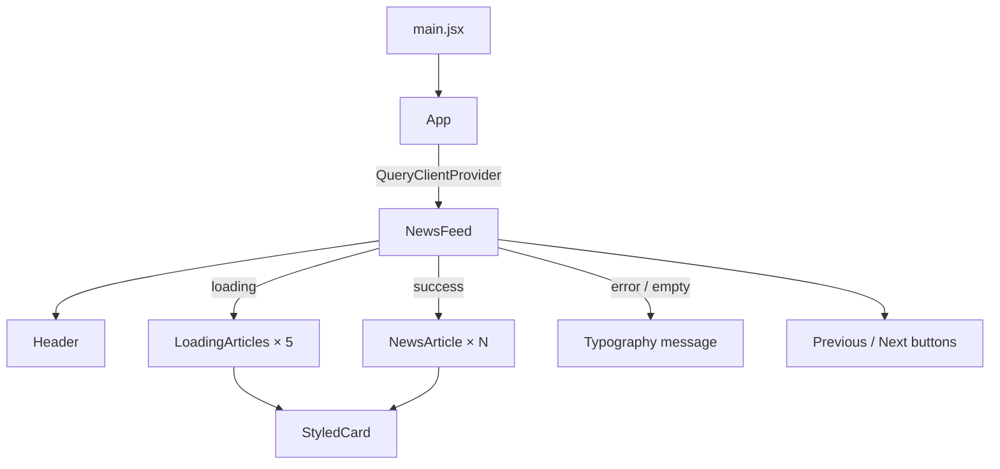
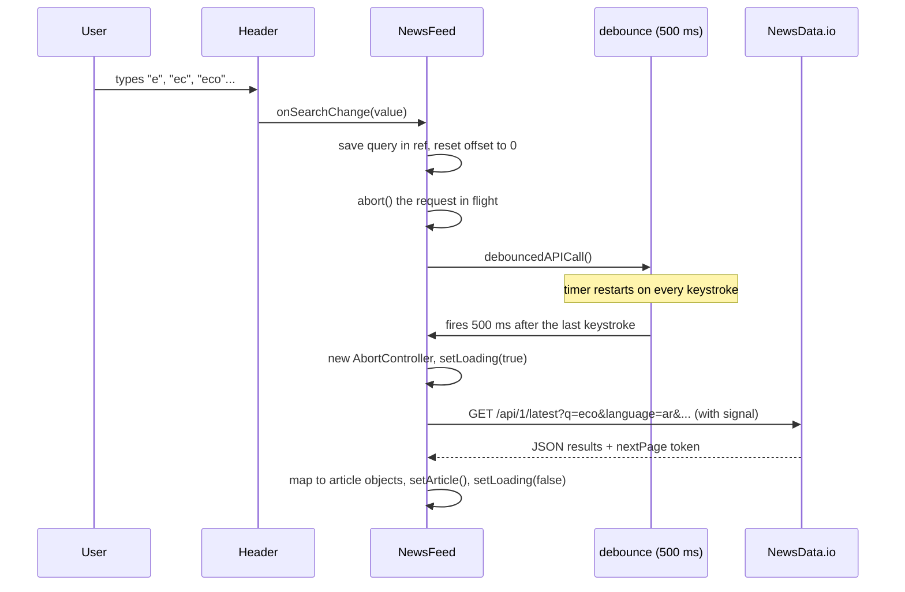

# News Feed App

> A multilingual React 19 news reader: read the latest news in Arabic, English, Turkish and 7 more languages, with right-to-left layout for Arabic and Urdu. You can search headlines as you type, filter by twelve topics, and page through the results. Each new keystroke cancels the request still in flight, so only the latest search ever reaches the screen.


<!-- Add a screenshot: save it as docs/screenshot.png, then uncomment the next line -->
<!--  -->

---

## Table of Contents

- [About the Project](#about-the-project)
- [Features](#features)
- [Tech Stack](#tech-stack)
- [Getting Started](#getting-started)
  - [Prerequisites](#prerequisites)
  - [Installation](#installation)
  - [Environment Variables](#environment-variables)
  - [Available Scripts](#available-scripts)
- [Usage](#usage)
- [Project Structure](#project-structure)
- [Architecture](#architecture)
  - [Component Tree](#component-tree)
  - [Request Lifecycle](#request-lifecycle)
  - [Debounce and Request Cancellation](#debounce-and-request-cancellation)
  - [Pagination](#pagination)
  - [UI States](#ui-states)
- [API Reference](#api-reference)
- [Components Reference](#components-reference)
- [Styling](#styling)
- [Known Limitations and Roadmap](#known-limitations-and-roadmap)
- [Contributing](#contributing)
- [License](#license)
- [Acknowledgments](#acknowledgments)

---

## About the Project

News Feed App is a single-page application that loads the latest articles from [NewsData.io](https://newsdata.io/) (a news API covering 90+ languages) and shows them as Material UI cards with an image, summary and author. Pick a language and the whole feed switches to it, including the text direction.

The project is a practical exercise in **handling asynchronous data in React the right way**:

- **Debouncing** user input so that typing doesn't send one request per keystroke.
- **Cancelling stale requests** with `AbortController`, so a slow old response can never overwrite a newer one.
- Treating a cancelled request (`AbortError`) as expected behaviour, not as an error.
- Showing clear **loading, error and empty states**.
- Keeping values that don't affect rendering in `useRef`, so they don't cause extra re-renders.

---

## Features

| Area | What you can do |
| --- | --- |
| **Latest stories** | See the latest articles with image, summary, author and date |
| **10 languages** | العربية (Arabic), English, Türkçe, Français, Deutsch, Español, Italiano, Português, Русский, اردو (Urdu) |
| **Right-to-left support** | Arabic and Urdu flip the whole feed to right-to-left (`dir="rtl"`) |
| **Live search** | Search headlines as you type. The request is sent 500 ms after you stop typing |
| **Request cancellation** | Every new keystroke, category change or page change cancels the request still in flight |
| **Category filter** | Filter by *All* or one of 12 topics: World, Politics, Business, Technology, Science, Health, Sports, Entertainment, Environment, Education, Lifestyle, Crime |
| **Pagination** | Use **Previous** and **Next** to move through the results, 10 articles per page |
| **Loading skeletons** | Five skeleton cards appear while articles load |
| **Error and empty states** | A clear message appears when the request fails or nothing matches |
| **Article links** | Click a card to open the original article |

---

## Tech Stack

| Category | Library | Purpose |
| --- | --- | --- |
| UI | [React 19](https://react.dev/) | Component library |
| Language | JavaScript (ES2022+, JSX) | Application code |
| Build tool | [Vite 8](https://vite.dev/) | Dev server with HMR and production bundler |
| Compiler | [React Compiler](https://react.dev/learn/react-compiler) (`babel-plugin-react-compiler`) | Automatic memoization at build time |
| Components | [Material UI 9](https://mui.com/material-ui/) + [Emotion](https://emotion.sh/) | `AppBar`, `Card`, `Select`, `Skeleton`, `Button` and other components, plus `styled()` |
| Icons | [@mui/icons-material](https://mui.com/material-ui/material-icons/) | Search icon |
| Font | [@fontsource/roboto](https://fontsource.org/fonts/roboto) | Self-hosted Roboto (weights 300 to 700) |
| Data layer | [TanStack Query 5](https://tanstack.com/query/latest) | `QueryClientProvider` set up at the app root |
| Utilities | [Lodash](https://lodash.com/docs/#debounce) | `debounce` for search, filter and paging requests |
| Styling | [Tailwind CSS 4](https://tailwindcss.com/) | Utility classes and global styles |
| Linting | [Oxlint](https://oxc.rs/docs/guide/usage/linter.html) | Fast linter with React and hooks rules |
| Data source | [NewsData.io](https://newsdata.io/), `/api/1/latest` | Articles in 90+ languages, with images, summaries and authors |

---

## Getting Started

### Prerequisites

- **Node.js** `20.19+` or `22.12+`. Vite 8 needs one of these versions.
- **npm**, which comes with Node.js.

### Installation

```bash
# 1. Clone the repository
git clone https://github.com/Abdallaheng2022/<repo-name>.git
cd <repo-name>

# 2. Install dependencies
npm install

# 3. Start the development server
npm run dev
```

Then open the URL printed in the terminal (usually <http://localhost:5173>).

### Environment Variables

The repository includes a `.env.example` file:

```bash
cp .env.example .env
```

| Variable | Required | Description |
| --- | --- | --- |
| `VITE_NEWSDATA_API_KEY` | **Yes** | Your NewsData.io API key. Without it, the app shows a "Missing API key" message |

> **Get a free key:** sign up at <https://newsdata.io/register> (no card needed) and copy your key from the dashboard into `.env`. Restart `npm run dev` after editing `.env`, because Vite only reads it at startup. The free plan includes 200 requests a day, 10 articles per request, and news delayed by about 12 hours.
>
> `.env` is listed in `.gitignore`, so it is never committed. Keep it that way. Also note that any variable starting with `VITE_` is embedded in the JavaScript sent to the browser, so it is **not** secret in production. A truly private key needs a small back end or serverless proxy.

### Available Scripts

| Command | Description |
| --- | --- |
| `npm run dev` | Starts the Vite dev server with Hot Module Replacement |
| `npm run build` | Builds an optimised production bundle into `dist/` |
| `npm run preview` | Serves the production build from `dist/` locally |
| `npm run lint` | Runs Oxlint on the project |

---

## Usage

1. **Browse.** The app opens on the latest news in Arabic. Pick another language from the language dropdown (to change the default, edit `DEFAULT_LANGUAGE` in `NewsFeed.jsx`).
2. **Search.** Type in the **Search** box in any language, for example `اقتصاد`. Results update shortly after you stop typing.
3. **Filter.** Pick a topic from the dropdown, or **All** to remove the filter. You can combine a filter with a search.
4. **Page.** Click **Next** for the following 10 articles, or **Previous** to go back. Changing the search, topic or language goes back to the first page.
5. **Read.** Click any card to open the full article on the publisher's site.

---

## Project Structure

```text
newsfeed_app/
├── public/
│   ├── favicon.svg              # Browser tab icon
│   └── icons.svg                # SVG sprite (from the Vite template)
├── src/
│   ├── assets/                  # Images from the Vite template (not used by the app)
│   ├── components/
│   │   ├── Header.jsx           # AppBar with title, search box and category dropdown
│   │   ├── LoadingArticles.jsx  # Skeleton card shown while articles load
│   │   ├── NewsArticle.jsx      # One article card: title, description, author, date, link
│   │   ├── NewsFeed.jsx         # Main container: state, fetching, debounce, cancellation, paging
│   │   └── StyledCard.jsx       # MUI Card styled with vertical spacing (styled API)
│   ├── App.css                  # App-level styles (currently empty)
│   ├── App.jsx                  # Root: Roboto font, global CSS, QueryClientProvider, <NewsFeed />
│   ├── index.css                # Tailwind import, CSS variables, light/dark base styles
│   ├── main.jsx                 # Entry point: mounts <App /> in <StrictMode>
│   └── useDebounce.js           # Reusable useDebounce(value, delay) hook
├── .env.example                 # Template for local environment variables
├── .gitignore                   # Ignores node_modules, dist and .env
├── .oxlintrc.json               # Oxlint rules (rules-of-hooks, only-export-components)
├── index.html                   # HTML shell; Vite injects the bundle here
├── package.json                 # Dependencies and npm scripts
└── vite.config.js               # React plugin, React Compiler (Babel), Tailwind, dev proxy
```

---

## Architecture

### Component Tree



`NewsFeed` owns all state. `Header` is a presentational component: it receives `onSearchChange`, `onCategoryChange` and `category` as props and reports user input back up.

### Request Lifecycle



### Debounce and Request Cancellation

Search, filtering and paging all go through **one** debounced function, created once with `useMemo(..., [])`. A new debounce created on every render would never actually delay anything.

| Ref | Holds | Why a ref (not state) |
| --- | --- | --- |
| `controllerRef` | The `AbortController` of the request in flight | Must survive renders so the *next* action can cancel it |
| `queryValue` | Current search text | Read inside the debounced callback without re-creating it |
| `categoryRef` | Current category | Same reason. The `category` state is kept only to drive the `<Select>` |
| `languageRef` | Current language code | Same reason. The `language` state drives the dropdown and the text direction |
| `pageTokensRef` | The `nextPage` token of every page reached | NewsData.io pages with tokens, so we remember them to go forward and back |
| `OffsetRef` | Current paging offset | Changes on every page click and doesn't need a re-render by itself |

How cancellation works:

1. On **every** keystroke, category change or page click, `controllerRef.current?.abort()` runs **immediately**, without waiting for the debounce.
2. When the debounce fires, a **new** `AbortController` is created, stored in the ref, and its `signal` is passed to `fetch`.
3. A cancelled `fetch` rejects with `AbortError`. The `.catch` handler **ignores** it, because cancellation is intentional and the newer request will update the UI.
4. On unmount, the `useEffect` cleanup cancels the request in flight and any pending debounce with `debouncedAPICall.cancel()`.

### Pagination

- The page size is `PAGE_SIZE = 10`, the free-plan maximum. **Next** adds 10 to the offset, and **Previous** subtracts 10, never going below 0.
- NewsData.io doesn't use page numbers. Each response includes a `nextPage` **token** for the following page. The app saves every token in `pageTokensRef` (index 0 = page 1 with no token, index 1 = token for page 2…), so **Previous** simply reuses a token saved on the way forward.
- **Previous** is disabled on the first page (offset 0).
- **Next** is disabled when the last response had fewer than 10 articles, or when the API returned no `nextPage` token (the last page).
- Both buttons are disabled while a request is loading.

### UI States

| State | Condition | What is shown |
| --- | --- | --- |
| Loading | `loading === true` | 5 × `LoadingArticles` skeleton cards |
| Success | `!loading && articles.length > 0` | One `NewsArticle` card per article |
| Empty | `!loading && articles.length === 0` | *"No articles found."* |
| Error | `error !== ""` | The error message in red, above the list |

---

## API Reference

The app calls the **latest news** endpoint of [NewsData.io](https://newsdata.io/documentation):

```text
GET https://newsdata.io/api/1/latest
```

| Parameter | Value sent | Meaning |
| --- | --- | --- |
| `apikey` | `VITE_NEWSDATA_API_KEY` | Your API key |
| `language` | e.g. `ar`, `en`, `tr` | Only articles written in this language (2-letter ISO 639-1 code) |
| `size` | `10` | Articles per page (free-plan maximum) |
| `category` | e.g. `sports` | Sent only when a topic is selected |
| `q` | search text, any language | Sent only when the search box is not empty |
| `page` | a `nextPage` token | Sent only for page 2 and later |

**Adding a language:** add one line to `LANGUAGES` in `Header.jsx`, for example `{ value: "id", label: "Bahasa Indonesia" }`. If it's written right to left, also add its code to `RTL_LANGUAGES` in `NewsFeed.jsx`.

**Response mapping.** Each item in `results` becomes:

```js
{
  author:      item.creator?.[0] ?? item.source_name ?? "",
  title:       item.title,
  description: item.description ?? "",
  url:         item.link,
  image:       item.image_url ?? null,
  publishedAt: item.pubDate as "YYYY-MM-DDTHH:mm:ssZ" (UTC),
}
```

The response's `nextPage` token is saved for the **Next** button. A missing key, a non-OK HTTP status, or a body whose `status` is not `"success"` shows an error message. The app uses the API's own message when there is one, such as *"API key is invalid"*.

---

## Components Reference

| Component | Props | Description |
| --- | --- | --- |
| `App` | — | Loads the Roboto font and global CSS, creates the `QueryClient`, and renders `NewsFeed` inside `QueryClientProvider` |
| `NewsFeed` | — | Holds `articles`, `loading`, `error`, `category` and `language` state and the refs. Fetches data, debounces input, cancels stale requests, sets the text direction, and renders the list and paging buttons |
| `Header` | `onSearchChange(value)`, `onCategoryChange(event)`, `category`, `onLanguageChange(event)`, `language` | MUI `AppBar` with the app title, a search input, a language `Select` (10 languages) and a category `Select` (*All* plus 12 topics) |
| `NewsArticle` | `title`, `description`, `image`, `author`, `publishedAt`, `url` | Card that links to the article. It shows an image when one exists, plus the author and the publish date in the local date format |
| `LoadingArticles` | — | Skeleton placeholder with the same shape as a `NewsArticle` card |
| `StyledCard` | MUI `Card` props | `Card` styled with `theme.spacing(2, 0)` for vertical spacing |
| `useDebounce` | `(value, delay = 500)` | Hook that returns `value` only after it has stopped changing for `delay` ms |

---

## Styling

- **Material UI** provides the components and theme. Styles are written with the `sx` prop and the `styled()` API (see `StyledCard`).
- **Tailwind CSS v4** is loaded through `@tailwindcss/vite` and imported in `index.css`.
- **`index.css`** defines CSS variables for colours, fonts and shadows, with a dark variant through `prefers-color-scheme`.
- **Roboto** is self-hosted with `@fontsource/roboto`, so no request goes to Google Fonts.
- The feed is centred in a fixed **900 px** column.

---

## Known Limitations and Roadmap

- [x] Debounced search with request cancellation
- [x] Category filter and offset paging
- [x] Loading skeletons, error and empty states
- [ ] Move fetching to **TanStack Query** (`useQuery` with `signal`). The provider is already set up, but requests are still made manually
- [ ] Replace Lodash `debounce` with the existing `useDebounce` hook, which is currently unused
- [ ] The dev proxy `/news-api` in `vite.config.js` is not used by the code. Use it or remove it
- [x] Multiple languages with right-to-left layout
- [ ] Translate the interface text (labels, buttons, messages) into the selected language
- [ ] Show dates in the selected language's format (`toLocaleDateString(language)`)
- [ ] Responsive layout for small screens (the column is a fixed 900 px)
- [ ] Add `@mui/material` to `package.json` as a direct dependency. It is currently installed only as a peer dependency of `@mui/icons-material`
- [ ] Unit tests (Vitest + React Testing Library)
- [ ] Remove unused Vite template assets (`hero.png`, `react.svg`, `vite.svg`)

---

## Contributing

Contributions, issues and feature requests are welcome.

1. Fork the project.
2. Create a feature branch: `git checkout -b feature/my-feature`
3. Commit your changes: `git commit -m "feat: add my feature"`
4. Make sure `npm run lint` and `npm run build` pass.
5. Push the branch: `git push origin feature/my-feature`
6. Open a Pull Request.

---

## License

No license has been chosen yet. Until one is added, all rights are reserved by the author. To make the project open source, add a `LICENSE` file (for example [MIT](https://choosealicense.com/licenses/mit/)) and update this section.

---

## Acknowledgments

- [NewsData.io](https://newsdata.io/) for the multilingual news data
- [Material UI](https://mui.com/) for the component library
- [TanStack Query](https://tanstack.com/query/latest), [Lodash](https://lodash.com/) and [Vite](https://vite.dev/)
